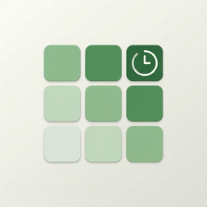

<p align="center">
  
</p>

# Activity — Personal Time Intelligence

> **Your time, visualized.**

**Activity** is a native macOS desktop application for personal time tracking and analytics. Built with **Tauri v2**, **Rust**, **SQLite**, and **React**, it combines a live menu bar timer, GitHub-style contribution heatmaps, project & activity tracking, and local-first data ownership.

---

## Features

- **Segment-based Timer Engine:** Each session records discrete UTC intervals (`time_segments`). Pausing closes the active segment and resuming opens a new one, so paused time is never counted.
- **macOS Menu Bar Tray & Popover:** Click the menu bar icon for a Raycast-style quick control popover (live timer, Quick Start by activity/project, today's breakdown, and streak), or right-click for quick menu actions.
- **Floating Desktop Widget:** Compact, draggable desktop widget (`Always on top` toggleable) that remembers its position and visibility across restarts.
- **Drift-free Recovery:** Elapsed time is always derived from UTC timestamps rather than JS intervals, staying accurate across window reloads and sleep/wake cycles.
- **Timezone & Midnight Splitting:** Sessions crossing local midnight are split cleanly across calendar days in your configured IANA timezone.
- **Overlap Protection:** Database constraints enforce at most one active/paused session at a time, and manual entries validate against existing segments to prevent overlaps.
- **Analytics & Contribution Matrix:** Overview dashboard, yearly contribution heatmap, daily breakdowns, period summaries, and activity comparisons.
- **Data Portability & Startup:** Native macOS save dialog export and import for JSON/CSV, plus optional silent Launch at Login in the menu bar.

---

## Prerequisites

- **macOS** (with Xcode Command Line Tools)
- **Node.js** 18+ and `npm`
- **Rust** 1.90+ (`rustup` / `cargo`)

---

## Getting Started

### Install dependencies

```bash
cd frontend
npm install
```

### Run in development (hot-reload)

Run from the repository root:

```bash
./frontend/node_modules/.bin/tauri dev
```

On first launch, Activity initializes a local SQLite database (`activity.db`) in the app data directory and seeds a starter catalog of activities and projects without sample sessions.

### Build the macOS `.app` bundle

```bash
./frontend/node_modules/.bin/tauri build --bundles app
```

---

## Running Tests

### Frontend unit tests & typecheck/build

```bash
cd frontend
npm run test
npm run build
```

### Rust backend tests & lints

```bash
cd src-tauri
cargo test
cargo clippy
```
